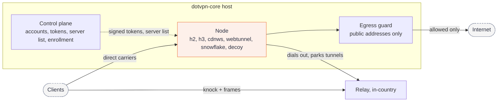

<picture>
  <source media="(prefers-color-scheme: dark)" srcset=".github/readme-header-dark.svg">
  
</picture>

# dotvpn-core

[](https://github.com/payam-foundation/dotvpn-core/actions/workflows/ci.yml)
[](https://github.com/payam-foundation/dotvpn-core/releases)
[](#status)
[](LICENSE)

The server side of [Dot VPN](https://github.com/payam-foundation/dotvpn-wire#related-repositories), a censorship-resistant VPN. One binary, `dotvpn-core`, runs the **node** (edge proxy with a decoy site and an SSRF-guarded egress), the **control plane** (accounts, tokens, server list, relay enrollment) and the **reverse listener** that in-country relays connect to.

## Status

Beta. Deployed and tested end to end ([test report](https://github.com/payam-foundation/dotvpn-lab/blob/main/docs/hetzner-test-report.md)), but the wire protocol is `v0.x` and may change. Pin exact release tags.

## How it works

A client reaches the node directly, or through an in-country relay. The relay never dials the node: the node dials out to the relay and parks tunnels there, so the node's address appears in no client configuration. The node checks tokens offline against control's public key, then connects to the internet only through an egress guard that refuses private addresses.



The admin API and `/metrics` are served on a loopback address or a unix socket only. Any other bind address is refused at startup.

## Install

Single host, control plane and node together, with a Let's Encrypt certificate:

```sh
curl -fsSL https://raw.githubusercontent.com/payam-foundation/dotvpn-core/main/deploy/install.sh \
  | sudo bash -s -- --role allinone --domain vpn.example.com --email you@example.com
```

Review the script before piping it to a shell. It downloads the release binary and verifies its SHA-256 against `checksums.txt` (verify the cosign signature yourself, see [Verify a release](#verify-a-release)), creates an unprivileged `dotvpn` user, writes `/etc/dotvpn/config.yaml`, installs a hardened systemd unit and enables BBR.

Docker (distroless, non-root, read-only root filesystem, all capabilities dropped, resource limits, health check):

```sh
export DOTVPN_VERSION=vX.Y.Z   # images are tagged by release version only; there is no "latest"
docker compose -f deploy/docker/compose.yaml run --rm dotvpn-core init \
  -role allinone -config /data/config.yaml -data-dir /data \
  -domain vpn.example.com -email you@example.com
docker compose -f deploy/docker/compose.yaml up -d
docker compose -f deploy/docker/compose.yaml exec dotvpn-core dotvpn-core invite -config /data/config.yaml
```

Hand the printed `dotvpn://` invite to a client (see [dotvpn-client](https://github.com/payam-foundation/dotvpn-client) or [dotvpn-android](https://github.com/payam-foundation/dotvpn-android)).

## Egress exits

By default a node dials destinations from its own IP. `node.egress` in the config picks the exit per destination and blocks others (see [ADR-021](docs/adr/021-egress-exits.md)):

```yaml
node:
  egress:
    ip_family: auto            # auto | v4 | v6
    default: direct
    exits:
      warp: {type: warp}                    # free account; add license: for WARP+ or Zero Trust
      tor:  {type: socks5, addr: 127.0.0.1:9050}
      psi:  {type: http, addr: 127.0.0.1:8081}
    block:
      domains: ["*.gov.ir"]
      cidrs: ["10.0.0.0/8"]
      cidr_files: {IR: /etc/dotvpn/geo/ir.txt}
    rules:
      - {match: {domains: ["*.openai.com"]}, exit: warp, fallback: direct}
      - {match: {cidrs: ["203.0.113.0/24"]}, exit: tor}
    udp: direct                # direct | block | a warp exit
```

Rules run in order, the first match wins. A down exit fails the connection unless the rule says `fallback: direct`. `*.example.com` matches subdomains, not the apex. Tor and Psiphon are sidecars you run; the node only dials them and watches their port. The WARP exit registers a free Cloudflare account on first start (accepting [Cloudflare's terms](https://www.cloudflare.com/application/terms/)) and stores it in `data_dir`.

`install.sh --egress-geo IR` downloads the Iran CIDR lists to `/etc/dotvpn/geo/` and blocks them. Metrics: `dotvpn_node_egress_exit_up{exit}` and `dotvpn_node_egress_dials_total{exit,result}`.

## Commands

| Command | Purpose |
|---|---|
| `init` | Write a config and keys for a role: `allinone`, `node` or `control`. |
| `allinone` | Control plane and node in one process. |
| `node` | Edge proxy. Joins a control plane with a one-time join token, or trusts static keys. |
| `control` | Accounts, tokens, quota, server list and relay enrollment. |
| `invite` | Print a client invite string. |
| `token` | Mint a bearer token for static deployments. |
| `healthcheck` | Query the loopback health endpoint (used by the container health check). |
| `version` | Print the version. |

Run `dotvpn-core <command> -h` for flags. Relays enroll with a one-time, signed enrollment token created through the admin API (`/v1/admin/relays`); there is no shared relay secret.

## Security model

- **Offline token checks.** Nodes verify Ed25519 tokens with control's public key and never call home per request.
- **SSRF guard.** The resolved IP is checked inside `net.Dialer.Control`, so DNS rebinding cannot reach loopback, RFC 1918 or link-local ranges such as `169.254.169.254`. The test-only `-tags e2e` build relaxes this and is never released.
- **Probe resistance.** A request without a valid knock or token gets the decoy site's answer, never a reset.
- **No trust in forwarded headers.** The rate limiter ignores `X-Forwarded-*` and `X-Real-IP`.
- **Supply chain.** Releases are signed with keyless cosign and ship an SPDX SBOM. CI runs `govulncheck`, `gosec`, `gitleaks` and `trivy`.

What this does not give you: anonymity from the operator of the node (it sees destinations), protection against a censor that blocks every carrier, or a guarantee about any specific country. The [lab](https://github.com/payam-foundation/dotvpn-lab#what-a-green-result-means) tests mechanisms against documented censor behaviour, not outcomes.

## UDP

Nodes carry UDP as length-framed datagrams over an authenticated tunnel stream ([ADR-018](https://github.com/payam-foundation/dotvpn-wire/blob/main/docs/adr/018-udp-over-tunnel-streams.md), wire `v0.2.0`) and advertise `udp=1` in the signed server list. The same user checks as TCP apply, plus a destination port allow-list (default 53, 123, 443, 3478), the SSRF guard, 256 flows per user and a 30 second idle timeout.

## Verify a release

```sh
cosign verify-blob --bundle checksums.txt.sigstore.json \
  --certificate-identity-regexp 'https://github.com/payam-foundation/dotvpn-core/' \
  --certificate-oidc-issuer https://token.actions.githubusercontent.com checksums.txt
sha256sum -c --ignore-missing checksums.txt
cosign verify ghcr.io/payam-foundation/dotvpn-core:vX.Y.Z \
  --certificate-identity-regexp 'https://github.com/payam-foundation/dotvpn-core/' \
  --certificate-oidc-issuer https://token.actions.githubusercontent.com
```

An SPDX SBOM ships next to each binary.

## Upgrade and rollback

Back up `/var/lib/dotvpn` (config and SQLite database) before upgrading across a minor version. Binary upgrades only apply additive migrations, but a rollback past a migration needs that backup restored.

| Install | Upgrade | Rollback |
|---|---|---|
| systemd | `install.sh --upgrade` | `install.sh --rollback` (restores `/usr/local/bin/dotvpn-core.prev` and restarts) |
| Docker | set `DOTVPN_VERSION` to the new tag, `docker compose up -d` | set it to the previous tag, `docker compose up -d` |

A wire major bump is a flag day for core, relay and client: roll all components back together (see [dotvpn-wire](https://github.com/payam-foundation/dotvpn-wire#versioning-and-compatibility)).

SQLite is the default store. PostgreSQL is supported behind the same store interface ([ADR-006](docs/adr/006-sqlite-default.md)).

## Development

Requires the Go version in `go.mod`.

```sh
go build ./... && go vet ./...
go test -race -count=1 ./...
go build -tags e2e ./cmd/dotvpn-core   # test-only build that allows loopback egress; never released
```

`go.mod` pins an exact `dotvpn-wire` tag. For side-by-side work with a sibling checkout use an untracked `go.work` in the parent directory (see CONTRIBUTING.md). CI tests against the pinned wire tag and wire `main`. Cross-component behaviour is covered by [dotvpn-lab](https://github.com/payam-foundation/dotvpn-lab).

Read [CONTRIBUTING.md](CONTRIBUTING.md) first. Report vulnerabilities as described in [SECURITY.md](SECURITY.md).

## Related repositories

| Repository | Role |
|---|---|
| [dotvpn-wire](https://github.com/payam-foundation/dotvpn-wire) | Shared wire protocol |
| [dotvpn-relay](https://github.com/payam-foundation/dotvpn-relay) | In-country stealth hop |
| [dotvpn-client](https://github.com/payam-foundation/dotvpn-client) | Client library and `dotvpn` CLI |
| [dotvpn-android](https://github.com/payam-foundation/dotvpn-android) | Android app |
| [dotvpn-lab](https://github.com/payam-foundation/dotvpn-lab) | Censorship lab, architecture and ADR index |

## License

[PolyForm Noncommercial License 1.0.0](LICENSE). Source-available, not open source: personal, research, educational and non-profit use is permitted; commercial use needs a separate licence from Payam Foundation.
